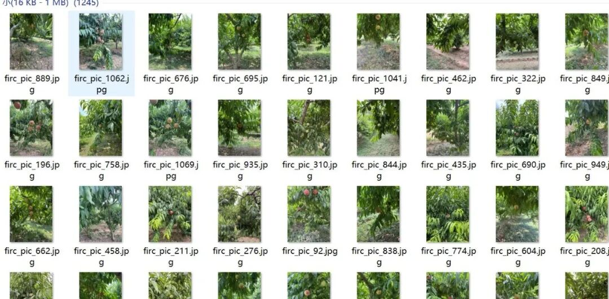
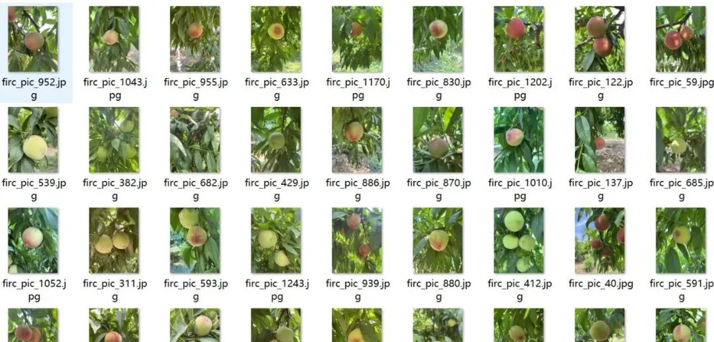
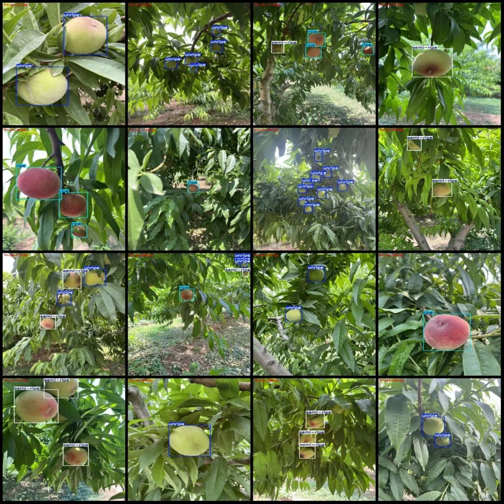
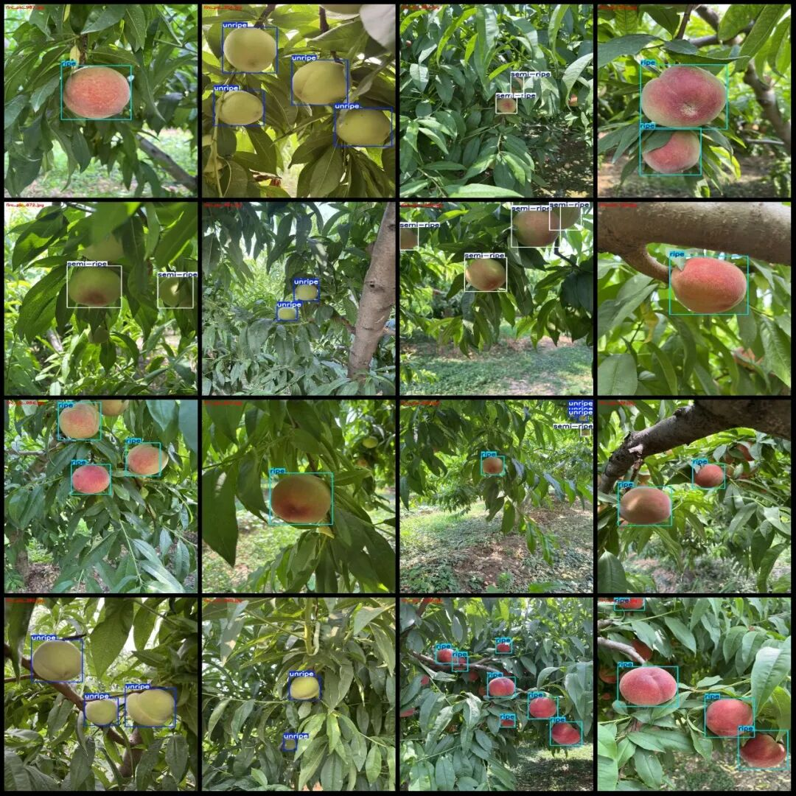

# Intelligent Orchard Peach Maturity Detection Dataset VOC+YOLO format with 1245 images in 3 categories

Dataset format: Pascal VOC format + YOLO format (txt file without split path, only containing jpg images and corresponding VOC format xml files and yolo format txt files)

Number of images (number of jpg files): 1245

Number of annotations (number of xml files): 1245

Number of annotations (number of txt files): 1245

Label category count: 3

Label category names (Note that the order of yolo format categories does not correspond to this, but is based on the labels folder's classes.txt): ["ripe", "semi-ripe", "unripe"]

Number of boxes labeled in each category:

ripe (mature) frame count = 1168

Semi-ripe (semi-ripe) Frame Count = 707

Unripe (unripe) Frames = 1618

Total frame count: 3493

Number of images per category:

ripe (mature) occupies a picture count = 496

Semi-ripe (half ripe) occupies a total of 403 images.

Unripe (unripe) occupies a picture count = 522

Image resolution: 1024x1365

Using labelImg:

Annotation rules: Draw a rectangle around the category.

Important Notice: The dataset does not have separate training, validation, and test sets; you need to partition them yourself.

Special : This dataset does not guarantee the accuracy of the trained models or weight files.

Image Preview:

Annotation example:

## Payment

Here is a pay link on Stripe ( https://buy.stripe.com/3cs8yP7sY87d0vu9AB ). Please contact me lonlonago@foxmail.com after funding $89, and I will send you a complete data files , thank you!

